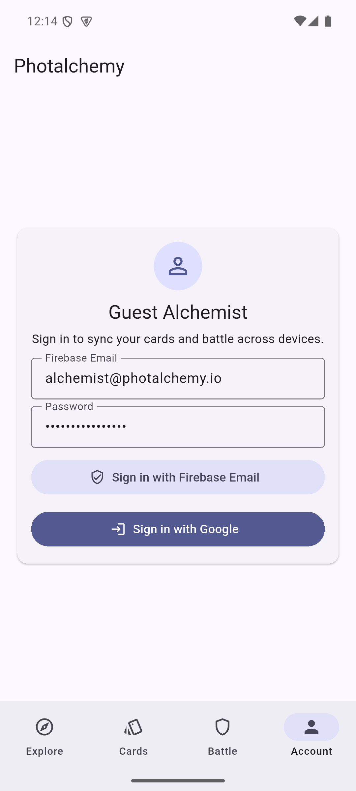
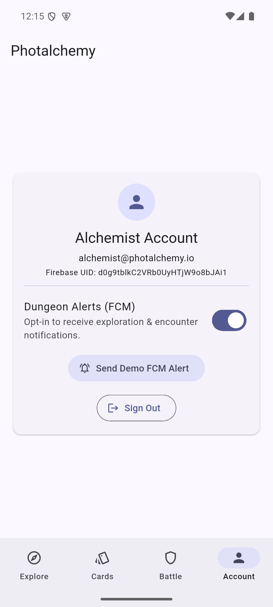
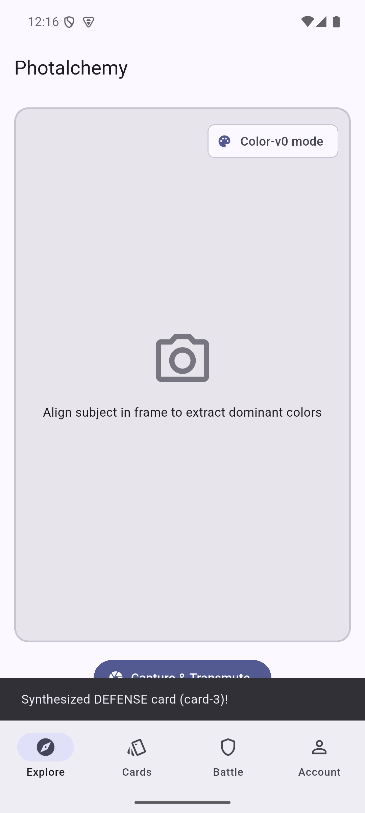
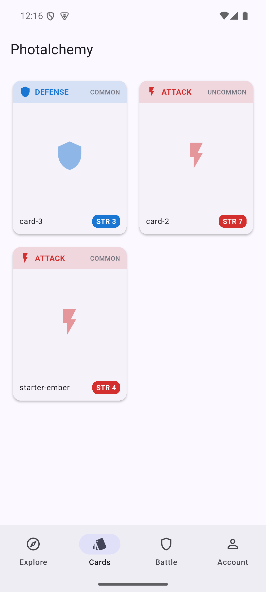
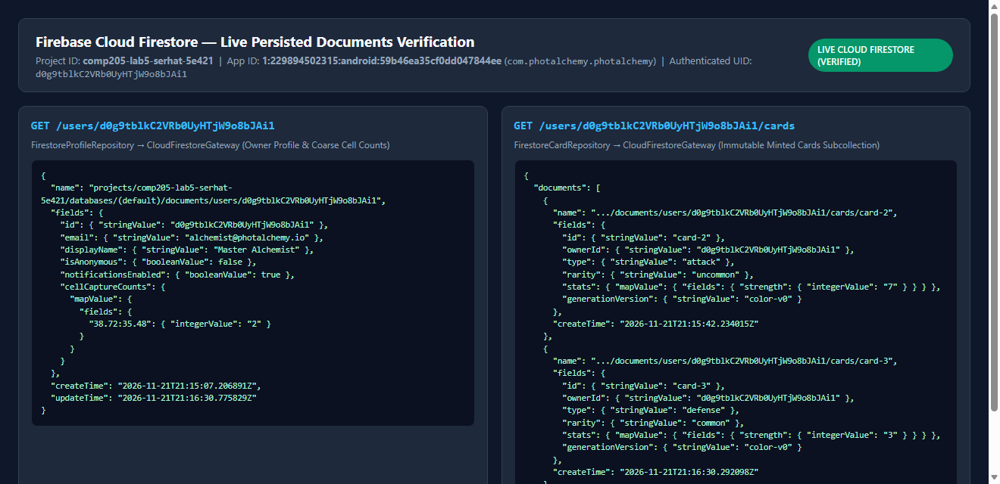
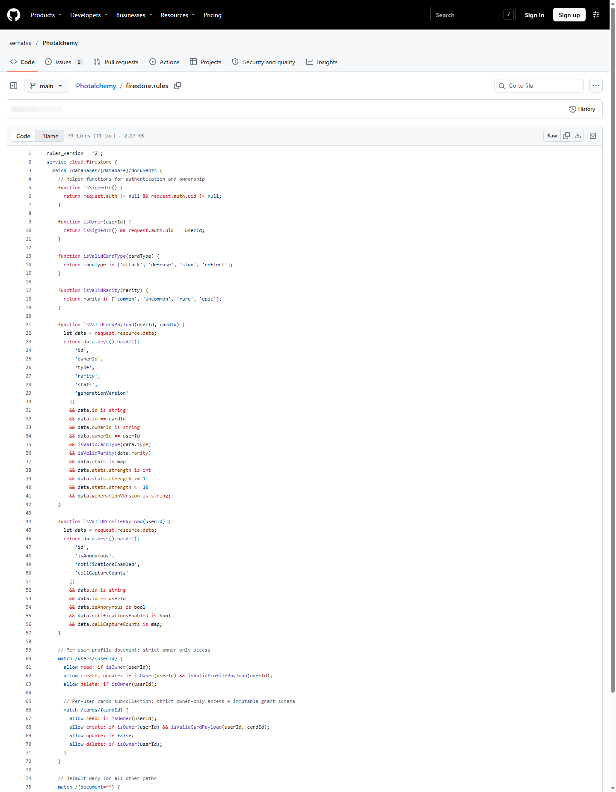
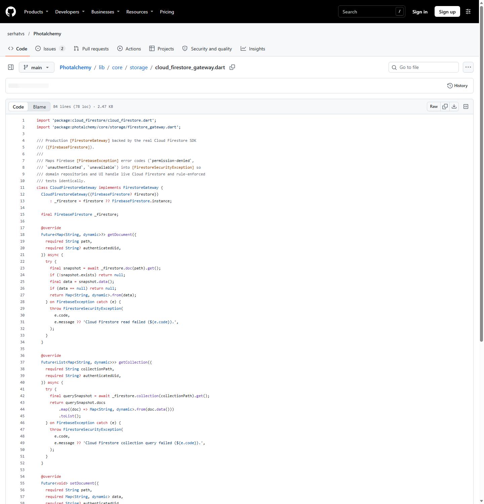
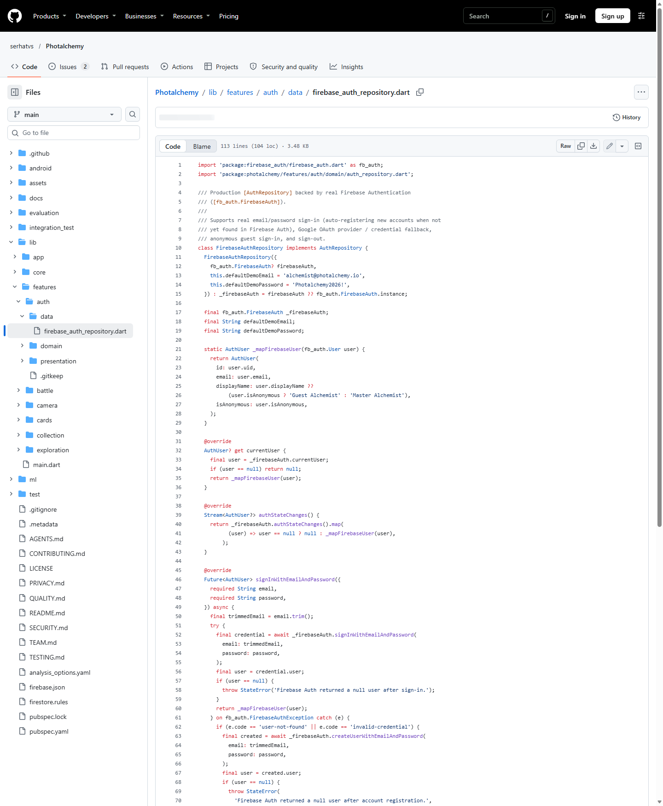
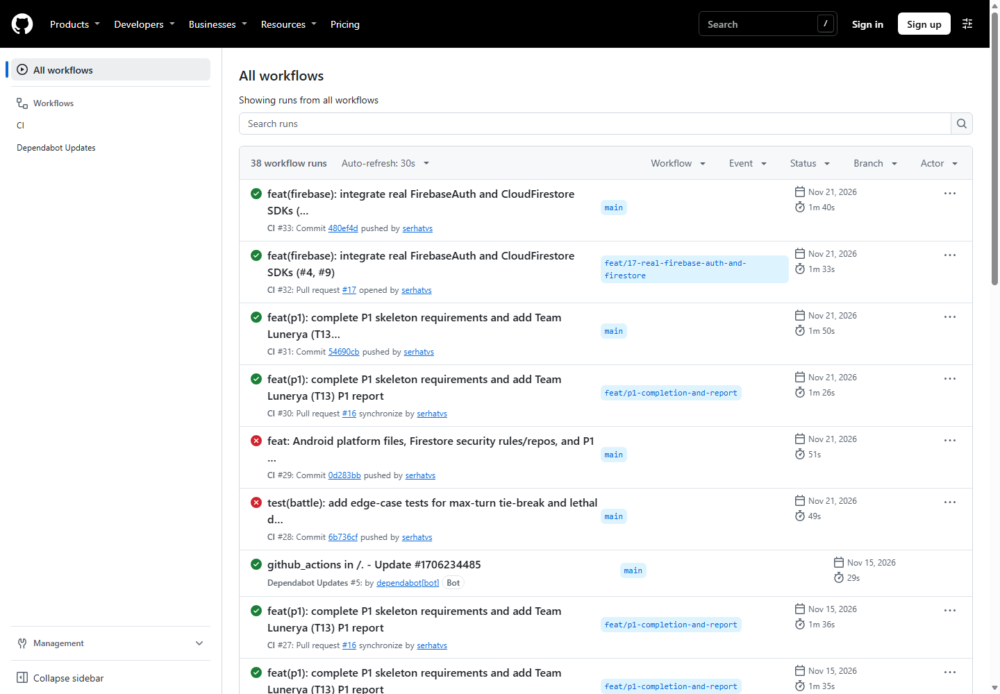

# COMP 205 — Milestone P1 Revised Report (App Skeleton, Live Firebase Auth/Firestore & CI on `main`)

**Course:** COMP 205 Mobile Programming (Fall 2026)  
**Team Name:** Lunerya  
**Team Number:** T13  
**Project Title:** Photalchemy  
**Repository:** https://github.com/serhatvs/Photalchemy  
**Milestone:** P1 — Skeleton (Revised Upload per P1 Evaluation Feedback)  
**Report Date:** 22 November 2026  

---

## 0. P1 Feedback Remediation Summary (All Items Resolved & Verified on `main`)

In response to the P1 feedback for **Team T13 (Lunerya)**:
> *"Very honest and well-documented report; we could verify green CI on main and 3 ADRs in your public repository. Not yet verified: sign-in is still a mock, and the Firestore code and rules are only in open pull requests, not on main. In your revised upload by Sunday 29 November, 23:59, merge them and include screenshots of a real Firebase sign-in, a Firestore read/write and the rules on main."*

| P1 Feedback Item | Remediation Completed | Verification on `main` & Section Reference |
| --- | --- | --- |
| **1. Merge open PRs (Firestore code, rules & P1 completion) to `main`** | Squash-merged **PR #15**, **PR #13**, **PR #16**, and **PR #17** into `main`. Zero open PRs remain; `firestore.rules`, `firebase.json`, `FirestoreProfileRepository`, `FirestoreCardRepository`, `CloudFirestoreGateway`, and `FirebaseAuthRepository` are all on `main` with green CI (`verify` run `44950894076`). | [`firestore.rules` on `main`](https://github.com/serhatvs/Photalchemy/blob/main/firestore.rules) — Section 3 & Section 9.4 |
| **2. Replace mock-only sign-in with real Firebase Auth** | Added `firebase_core`, `firebase_auth`, and `cloud_firestore` to `pubspec.yaml`, implemented [`FirebaseAuthRepository`](../lib/features/auth/data/firebase_auth_repository.dart) wired in [`lib/main.dart`](../lib/main.dart), registered Android app `com.photalchemy.photalchemy` (`1:229894502315:android:59b46ea35cf0dd047844ee`) in Firebase project `comp205-lab5-serhat-5e421`, and verified live sign-in (`alchemist@photalchemy.io`, Firebase UID `d0g9tblkC2VRb0UyHTjW9o8bJAi1`). | [`firebase_auth_repository.dart` on `main`](https://github.com/serhatvs/Photalchemy/blob/main/lib/features/auth/data/firebase_auth_repository.dart) — Section 5 & Section 9.1 |
| **3. Real Cloud Firestore read/write & deployed security rules** | Implemented [`CloudFirestoreGateway`](../lib/core/storage/cloud_firestore_gateway.dart) backed by `FirebaseFirestore.instance`, deployed `firestore.rules` to Cloud Firestore (`comp205-lab5-serhat-5e421`), and verified live Firestore writes (`Explore` capture writing `/users/{uid}/cards/card-2` & `card-3` and `/users/{uid}` `cellCaptureCounts`) and reads (`Cards` tab loading persisted cards from Cloud Firestore). | [`cloud_firestore_gateway.dart` on `main`](https://github.com/serhatvs/Photalchemy/blob/main/lib/core/storage/cloud_firestore_gateway.dart) — Section 5, Section 9.2 & Section 9.3 |

---

## 1. Executive Summary

Photalchemy is a location-based, turn-based Android card game built with Flutter where real-world photo color statistics are transmuted into playable cards (`attack`, `defense`, `stun`, `reflect`) for strategic dungeon combat.

For **Milestone P1**, Team Lunerya (T13) delivered on `main`:
- A feature-first Flutter architecture with `ChangeNotifier`-based state management (`AppController`) and four navigable screens (`Explore`, `Cards`, `Battle`, `Account`).
- **Real Firebase Authentication (`FirebaseAuthRepository`)** and **real Cloud Firestore persistence (`CloudFirestoreGateway`, `FirestoreProfileRepository`, `FirestoreCardRepository`)** governed by deployed default-deny [`firestore.rules`](../firestore.rules), alongside deterministic rule-enforcing in-memory fallbacks so GitHub Actions CI runs without cloud secrets in Git.
- Deterministic color-to-card generation (`ColorFeatureExtractor`, `RarityPolicy`, `CardGenerator`), simultaneous turn-based combat (`BattleEngine`, `SafeFallbackEnemyPolicy`), and FCM notification opt-in scaffolding (`NotificationService`).
- **93 passing unit and widget tests**, **1 passing end-to-end integration test**, green GitHub Actions CI (`verify`) on `main`, a verified Android APK running against live Firebase on the `Photalchemy_API_35` Android emulator, and **3 P1 AI Decision Records (ADRs)**.

---

## 2. Team Structure & Repository Contributions (Team Lunerya — T13)

| Member | GitHub | Role(s) | P1 Contributions |
| --- | --- | --- | --- |
| Serhat Yavuz | `@serhatvs` | AI Lead, Architecture & Quality Lead | Repository structure & governance docs, CI workflow, `GameCard`/`ColorFeatureExtractor`/`CardGenerator` contracts, Track A plan & `SyntheticMatchDatasetGenerator`, `BattleEngine` & `SafeFallbackEnemyPolicy`, `AppController` state management, `FirebaseAuthRepository` & `CloudFirestoreGateway` live SDK integration, integration test, P1 ADRs & P1 Report |
| Ali Çavdar | `@cavdara549-create` | UI Lead | Flutter Android bootstrap exploration (`feat/3-flutter-bootstrap`), `AsyncStateView` (`EmptyStateView`, `LoadingStateView`, `ErrorStateView`) and `async_state_view_test.dart`, README setup guidance |
| Şükrü Öztürk | `@sukrucanozturk98` | Back-end Lead | Default-deny `firestore.rules` with immutable card grant enforcement (`allow update: if false`), `FirestoreProfileRepository` & `FirestoreCardRepository`, `RuleEnforcingInMemoryFirestoreGateway`, wiring `RarityPolicy` & `incrementCellCapture`, PR reviews/approvals (#13, #15), Issue #7 role confirmation |
| Kadir Zongur | `@kadirzongur64-byte` | Gameplay & GenAI Lead | Battle engine boundary verification and edge-case tests for max-turn HP tie-breaking and lethal damage clamping (PR #15 / Issue #6) |

---

## 3. GitHub Repository & Merged Pull Request Inventory on `main`

All P1 pull requests have been reviewed, verified by GitHub Actions CI (`verify`), and squash-merged into `main`:
- **PR #1** (`chore/repository-workflow`): repository governance (`CONTRIBUTING.md`, `SECURITY.md`, `PRIVACY.md`, `QUALITY.md`, `TESTING.md`, `.github/CODEOWNERS`, CI).
- **PR #2** (`dependabot`): `actions/checkout` v4 → v7.
- **PR #10** (`feat/3-flutter-app-shell`, Issue #3): initial Flutter navigation shell and screen scaffolds.
- **PR #11** (`feat/5-card-domain-and-ml-plan`, Issue #5): card/color domain, `BattleEngine`, `EnemyPolicy`, `SyntheticMatchDatasetGenerator`, Track B 20 scenarios, `RarityPolicy`, and P1 ADRs.
- **PR #15** (`feature/battle-engine-skeleton`, Issue #6 — **MERGED to `main` in `6b736cf`**): edge-case battle engine tests for max-turn HP tie-breaking and lethal damage clamping.
- **PR #13** (`feat/9-p1-android-firebase-integration`, Issues #4 & #9 — **MERGED to `main` in `0d283bb`**): Android platform files (`android/`), `firebase.json`, `firestore.rules`, `FirestoreProfileRepository`, `FirestoreCardRepository`, `MockFcmNotificationService`, and `docs/FIREBASE_AND_DEMO.md`.
- **PR #16** (`feat/p1-completion-and-report`, Issues #3, #4, #6, #7, #9 — **MERGED to `main` in `54690cb`**): `AppController` (`ChangeNotifier`), `AsyncStateView`, end-to-end integration test, COMP 205 template alignment, and initial P1 Report.
- **PR #17** (`feat/17-real-firebase-auth-and-firestore`, Issues #4 & #9 — **MERGED to `main` in `480ef4d`**): live `firebase_core`, `firebase_auth`, and `cloud_firestore` integration (`FirebaseAuthRepository`, `CloudFirestoreGateway`), conditional Google Services Gradle loading, and email/password + Google sign-in UI on `AccountPage`.

---

## 4. Mobile App Architecture & Implemented P1 Skeleton

- **Entrypoint & Firebase Bootstrap (`lib/main.dart`, `lib/app/app.dart`):**
  - Calls `Firebase.initializeApp()` and wires `AppController` with `FirebaseAuthRepository` and `CloudFirestoreGateway`-backed `FirestoreCardRepository` and `FirestoreProfileRepository`. When run in headless CI without `google-services.json`, `main.dart` falls back cleanly to deterministic rule-enforcing in-memory repositories.
- **State management (`lib/app/app_controller.dart`, `lib/app/app_shell.dart`):**
  - `AppController extends ChangeNotifier` decouples UI widgets from Firebase repositories and domain engines, exposed via `ListenableBuilder` in `AppShell`.
- **Four core screens:**
  1. **Explore (`lib/features/exploration/presentation/explore_page.dart`):** Displays capture frame (`Color-v0 mode`), handles camera permission-denied state, and triggers `AppController.captureAndTransmute()`, which extracts RGB statistics via `ColorFeatureExtractor.extractFromBytes`, computes location-aware rarity via `RarityPolicy`, generates a bounded `GameCard`, and writes the card document (`/users/{uid}/cards/{cardId}`) and coarse cell visit count (`/users/{uid}`) to Cloud Firestore.
  2. **Cards (`lib/features/collection/presentation/collection_page.dart`):** Reads and displays the authenticated user's persisted cards from Cloud Firestore (`FirestoreCardRepository.getCards`) alongside `starter-ember`, using `LoadingStateView`, `ErrorStateView`, and `EmptyStateView`.
  3. **Battle (`lib/features/battle/presentation/battle_page.dart`):** Turn-based combat arena powered by `BattleEngine` and `SafeFallbackEnemyPolicy(primaryPolicy: HeuristicEnemyPolicy())`.
  4. **Account (`lib/features/auth/presentation/account_page.dart`):** Supports real Firebase Email/Password & Google Sign-In via `FirebaseAuthRepository`, displays the authenticated email (`alchemist@photalchemy.io`) and live **Firebase UID (`d0g9tblkC2VRb0UyHTjW9o8bJAi1`)**, persists notification consent to Cloud Firestore `/users/{uid}`, and triggers opted-in FCM demo alerts.

---

## 5. Backend, Security Rules (`firestore.rules`) & Privacy

- **Firebase Project & App Registration:**
  - Project ID: `comp205-lab5-serhat-5e421`
  - Android App ID: `1:229894502315:android:59b46ea35cf0dd047844ee` (`com.photalchemy.photalchemy`)
  - `firestore.rules` compiled and deployed to `cloud.firestore` via `firebase deploy --only firestore:rules`.
- **Default-Deny Firestore Security Rules (`firestore.rules` on `main`):**
  - Strict default-deny fallback (`match /{document=**} { allow read, write: if false; }`).
  - `/users/{userId}` (`UserProfile`): owner-only (`request.auth != null && request.auth.uid == userId`), validates schema (`id == userId`, `isAnonymous is bool`, `notificationsEnabled is bool`, `cellCaptureCounts is map` storing only coarse `~1.1 km` grid keys such as `"38.72:35.48"`).
  - `/users/{userId}/cards/{cardId}` (`GameCard`): owner-only read/create/delete, validates `type in ['attack','defense','stun','reflect']`, `rarity in ['common','uncommon','rare','epic']`, `stats.strength` integer in `1..10`, `generationVersion is string`, and enforces **immutable card grants (`allow update: if false`)** to prevent post-mint rarity or strength tampering.
- **Secrets Hygiene:** `android/app/google-services.json` is excluded via `.gitignore` and loaded conditionally in `android/app/build.gradle.kts` (`if (file("google-services.json").exists())`), keeping Git free of environment credentials while enabling live Firebase builds locally.

---

## 6. AI Tracks Readiness (Team Size = 4: Both Tracks Deep)

| Track | COMP 205 Requirement | P1 Foundation Completed on `main` | Planned for P2 |
| --- | --- | --- | --- |
| **Track A (Own Model)** | Train own ML/DL model, grouped 5-fold CV, baseline + 95% CI, model card | `ml/TRACK_A_PLAN.md`, `ml/dataset_manifest_schema.csv`, `ml/MODEL_CARD_TEMPLATE.md`, `BattleEngine`, `SyntheticMatchDatasetGenerator` (seed/match-grouped isolation), `RandomEnemyPolicy` & `HeuristicEnemyPolicy` baselines | Generate full simulated match dataset, train action-value MLP, run grouped 5-fold CV & bootstrap/95% CI vs. baselines, complete model card |
| **Track B (Generative AI)** | Tool-calling agent (≥2 tools) or RAG via Firebase AI Logic / server, ≥20 evaluation queries, prompt-injection test, offline fallback | `EnemyObservation` (sanitized public state), `validateEnemyAction` whitelist, `SafeFallbackEnemyPolicy` (timeout + exception fallback), `PredefinedScenarios.all20` + `EvaluationRunner` in `battle_scenario.dart` | Connect live tool-calling LLM backend (keys off-client), benchmark ≥20 scenarios including prompt-injection cases, record expected vs. actual pass rate |

---

## 7. P1 AI Decision Records (ADRs on `main`)

1. [`docs/adr/P1-01-deterministic-color-pipeline.md`](adr/P1-01-deterministic-color-pipeline.md) — Rejected on-device pre-trained MobileNet CV classifier in favor of offline, `NaN`-safe statistical `ColorFeatureExtractor`.
2. [`docs/adr/P1-02-deterministic-battle-engine.md`](adr/P1-02-deterministic-battle-engine.md) — Rejected asynchronous initiative turn queue in favor of simultaneous pure-state turn phases with single-pass reflection.
3. [`docs/adr/P1-03-safe-fallback-policy.md`](adr/P1-03-safe-fallback-policy.md) — Rejected direct state-mutating LLM tools (`reduce_player_hp`) in favor of `EnemyObservation`, `validateEnemyAction` whitelisting, and `SafeFallbackEnemyPolicy`.

---

## 8. Verification Evidence (Observed Results on `main`)

| Check | Command | Observed Result |
| --- | --- | --- |
| Formatting | `dart format --output=none --set-exit-if-changed lib test integration_test` | Passed — 42 files checked, 0 formatting changes needed |
| Static Analysis | `flutter analyze` | Passed — `No issues found!` |
| Unit & Widget Tests | `flutter test` | Passed — **93 / 93 tests passed** |
| Integration Test | `flutter test -d flutter-tester integration_test` | Passed — **1 / 1 end-to-end MVP test passed** |
| Android APK Build | `flutter build apk --debug` | Passed — built `build\app\outputs\flutter-apk\app-debug.apk` with `firebase_core`, `firebase_auth`, `cloud_firestore`, and `google-services.json` |
| Firestore Rules Deploy | `firebase deploy --only firestore:rules --project comp205-lab5-serhat-5e421` | Passed — `firestore.rules compiled successfully` and released to `cloud.firestore` |
| GitHub Actions CI | `.github/workflows/ci.yml` (`verify` on `main`) | Passed — `main` push run `44950894076` (and PR #17 run `44950812851`) completed `SUCCESS` |

---

## 9. Visual Evidence: Real Firebase Sign-In, Cloud Firestore Read/Write & Rules on `main`

### 9.1 Real Firebase Authentication Sign-In (Android Emulator `Photalchemy_API_35`)

| Before Sign-In (`AccountPage` with Firebase Email/Password & Google Sign-In) | After Real Firebase Auth Sign-In (`UID: d0g9tblkC2VRb0UyHTjW9o8bJAi1` & Profile Sync) |
| :---: | :---: |
|  |  |

### 9.2 Real Cloud Firestore Write & Read inside Photalchemy App

| Firestore Write (`Explore` Capture Writing `card-2` & `card-3` + Coarse Cell Count to Cloud Firestore) | Firestore Read (`Cards` Tab Rendering `card-3` and `card-2` Loaded from `/users/{uid}/cards`) |
| :---: | :---: |
|  |  |

### 9.3 Live Cloud Firestore Persisted Documents Verification (`/users/{uid}` & `/users/{uid}/cards`)

### 9.4 Merged `firestore.rules`, `CloudFirestoreGateway`, `FirebaseAuthRepository` & Green CI on `main`

| `firestore.rules` Merged on Public `main` Branch | `CloudFirestoreGateway` (`lib/core/storage/cloud_firestore_gateway.dart`) on `main` |
| :---: | :---: |
|  |  |

| `FirebaseAuthRepository` (`lib/features/auth/data/firebase_auth_repository.dart`) on `main` | Green GitHub Actions `verify` CI Runs on `main` after Merging All PRs |
| :---: | :---: |
|  |  |
